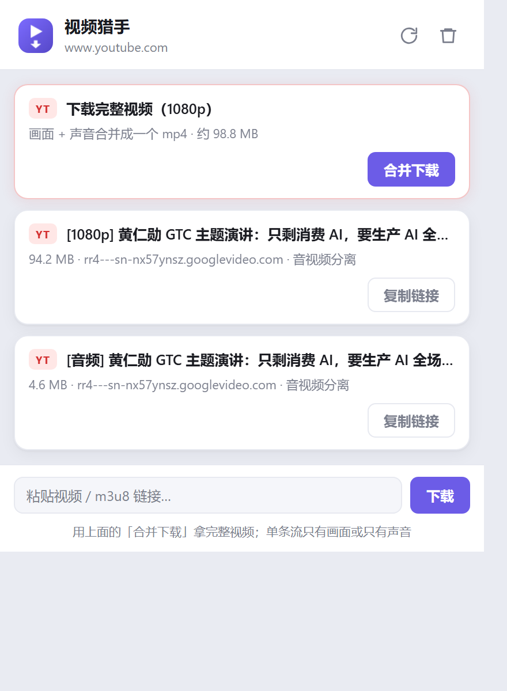

# 视频猎手 · Video Hunter

把网页里正在播放的视频下载到本地。三种形态覆盖不同场景：
**浏览器扩展**（轻量）、**桌面客户端**（全窗口嗅探）、**命令行脚本**（站点最多）。



## 三条路线

| | 浏览器扩展 | 桌面客户端 | `ytdl.py` |
| --- | --- | --- | --- |
| 适合 | 临时看到想存的视频 | 任何程序里的视频流 | 批量、高画质、受支持的站点 |
| 覆盖 | 任意网页的 MP4 / HLS / DASH | 走系统代理的所有 HTTP(S) 流量 | yt-dlp 支持的 1000+ 站点 |
| 多线程 | 6 路（HLS 分片） | 8 路 + 断点续传 | yt-dlp 自己管 |
| 依赖 | 无 | Python + openssl | 首次运行自动下载 yt-dlp.exe |

## 功能

**浏览器扩展**

- 自动嗅探页面加载的视频：MP4 直链、HLS（`.m3u8`）、DASH（`.mpd`）
- HLS 分片并发下载、本地合并，支持 **AES-128 解密**
- **YouTube / B 站**：音视频双流下载，在浏览器内重新封装成单个 mp4 —— 不需要 ffmpeg
- 多码率选择、手动粘贴链接、DRM 识别
- 角标实时显示抓到几个视频 / 下载进度

**桌面客户端**

- 本地 MITM 代理，**任何走系统代理的程序**的视频流都能抓（浏览器、桌面客户端、播放器）
- HTTPS 解密：本地 CA 给每个域名现签证书
- 多线程分段下载 + 断点续传（`.vhmeta`）
- HLS 解析 / 并发分片 / AES-128 解密
- 系统代理一键开关，Web 控制台看列表和进度

**`ytdl.py`**

- 基于 yt-dlp，首次运行自动下载运行环境（带镜像回退）
- 支持批量、播放列表、纯音频
- 检测 ffmpeg，没有时自动降级到已合并的单文件格式

## 快速开始

### 扩展

1. 打开 `chrome://extensions`（Edge 用 `edge://extensions`）
2. 右上角打开 **开发者模式**
3. 点 **加载已解压的扩展程序**，选择 `video-hunter/` 目录
4. 打开有视频的页面，**先点一下播放**，再点工具栏图标

详细说明和常见问题见 [video-hunter/README.md](video-hunter/README.md)。

### 桌面客户端

```bat
cd video-hunter-desktop
install_ca.bat   :: 第一次用，装根证书
run.bat
```

启动后打开 `http://127.0.0.1:8900/`，点「开启系统代理」，
然后在任意程序里播放视频。

**注意**：根证书是 HTTPS 解密的前提；不装的话只能看到 HTTP 流量。
详见 [video-hunter-desktop/README.md](video-hunter-desktop/README.md)。

### 脚本

```bash
python ytdl.py
```

Windows 上也可以双击 `run.bat`。

## 能力边界

**能下**：MP4 / WebM 直链、无加密 HLS、AES-128 加密 HLS、带防盗链的流、fMP4 切片、YouTube 1080p 及以下

**下不了**：

| 类型 | 原因 |
| --- | --- |
| DRM（Widevine / PlayReady / FairPlay） | 链接和分片都能拿到，但密钥在浏览器 CDM 内，JS 读不到 |
| SAMPLE-AES 加密 | 本质是 DRM |
| DASH + ContentProtection | 同上 |
| YouTube 4K（VP9 / AV1） | 扩展只处理 H.264 + AAC |
| 切片渲染 / Canvas 播放 | 没有独立的视频流可抓 |
| 直播流 | 只能下到已生成的分片，相当于录一段 |

> DRM 拦的不是链接，是密钥。你能拿到 m3u8，也能下载每个 `.ts` 分片，
> 但解密发生在浏览器 CDM（独立于 JS 的闭源组件）里，明文直接进解码器，JS 全程接触不到。

## 技术要点

- **嗅探**：`chrome.webRequest` 读响应头 `content-type` / `content-length`，
  URL 后缀 + MIME 双重判断，过滤 30KB 以下的广告和预览
- **为什么用 offscreen 文档**：MV3 的 service worker 里没有 `URL.createObjectURL`，
  大文件又不能用 data URL，所以分片下载和 Blob 合并都放在离屏文档
- **HLS 解密**：WebCrypto `AES-CBC`，IV 缺省时按分片序号（16 字节大端）推导
- **YouTube 合并**：mp4box 解封装出原始帧，mp4-muxer 重新封装，
  相当于用纯 JS 实现 `ffmpeg -c copy` 的效果
- **Referer 伪装**：`declarativeNetRequest` 会话规则 + `initiatorDomains`，
  只影响扩展自己发出的请求，任务结束即删除

## 目录结构

```
.
├── video-hunter/          浏览器扩展（Manifest V3）
│   ├── manifest.json
│   ├── background.js      嗅探、列表维护、任务调度
│   ├── hls.js             HLS 解析 / 并发下载 / AES 解密
│   ├── yt-download.js     YouTube 音视频合并
│   ├── offscreen.*        离屏文档（承担需要 DOM 的重活）
│   ├── popup.*            界面
│   └── lib/               mp4box + mp4-muxer
├── ytdl.py                命令行下载器
├── run.bat                Windows 启动脚本
└── youtube-preview.png    界面截图
```

## 注意

请只下载你有权保存的内容。这个工具不做 DRM 绕过。
