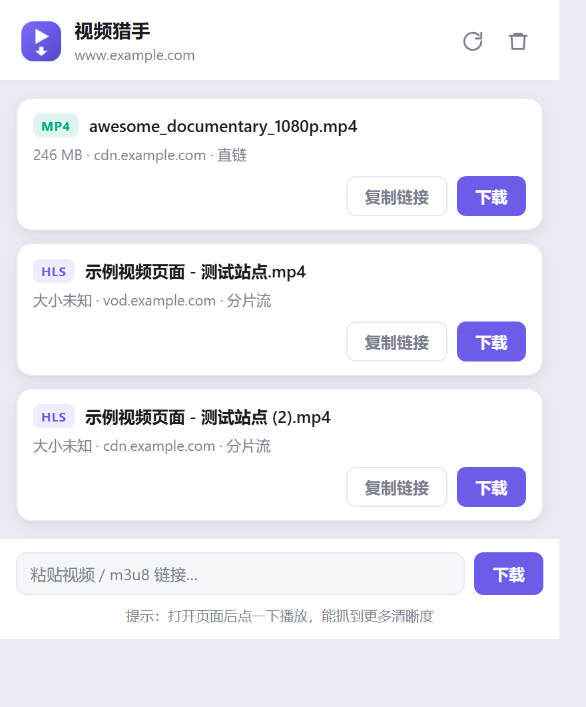

# 视频猎手 · Video Hunter

一个 Chrome / Edge 浏览器扩展，用来嗅探网页里正在播放的视频并下载到本地。



## 能做什么

- **自动嗅探**页面加载的视频资源：MP4 直链、HLS（`.m3u8`）、DASH（`.mpd`）
- **MP4 直链**一键下载，交给浏览器原生下载器（支持断点续传）
- **HLS 分片流**：解析播放列表 → 并发下载全部分片（6 路）→ 本地合并成一个文件
- **AES-128 加密的 HLS**：自动抓密钥、按分片 IV 解密
- **多码率选择**：master playlist 会列出所有清晰度让你挑
- **手动粘贴链接**下载
- 角标实时显示当前页抓到几个视频 / 下载进度

## 安装

1. 打开 Chrome，地址栏输入 `chrome://extensions`
   （Edge 用 `edge://extensions`）
2. 右上角打开 **开发者模式**
3. 点 **加载已解压的扩展程序**，选择本目录 `video-hunter`
4. 工具栏出现紫色播放图标即成功（建议点图钉固定到工具栏）

## 使用

1. 打开有视频的网页，**先点一下播放**
   （很多站点不开始播放就不会去请求视频流）
2. 点扩展图标，列表里会出现当前页抓到的视频
3. 点 **下载**

### HLS 下载说明

- 有多个清晰度时会弹出选择面板，选一个开始
- 下载时扩展图标上显示进度百分比，合并完成后浏览器自动保存
- **文件格式**：HLS 合并出来通常是 `.ts`（MPEG-TS）
  - PotPlayer / VLC / MPV 直接能播
  - 想转成 mp4：`ffmpeg -i input.ts -c copy output.mp4`
  - 如果站点用的是 fMP4 切片（`.m4s`），合并出来就是标准 `.mp4`

## 能力边界

**能下载**

| 类型 | 说明 |
| --- | --- |
| MP4 / WebM / MOV 直链 | 交给浏览器原生下载器，支持断点续传 |
| HLS 无加密 | 分片直接拼接 |
| HLS + AES-128 | 密钥写在播放列表里，自动解密 |
| HLS + 防盗链 | 已内置 Referer / Origin 伪装，多数站点能过 |
| HLS 多码率 | master playlist 会列出清晰度让你选 |
| fMP4 切片（.m4s） | 含 init segment 拼接，输出标准 mp4 |

**不能下载**

| 类型 | 原因 |
| --- | --- |
| DRM（Widevine / PlayReady / FairPlay） | 链接和分片都能拿到，但密钥在浏览器 CDM 内，JS 读不到 |
| SAMPLE-AES 加密 | 本质就是 DRM，扩展会直接提示 |
| DASH + ContentProtection | 扩展不支持 DASH；带 DRM 时换任何工具都不行 |
| YouTube 4K（VP9 / AV1） | 扩展只支持 H.264 + AAC；1080p 及以下可直接合并 |
| 切片渲染 / Canvas 播放 | 根本没有独立的视频流可抓 |
| 直播流 | 只能下到已生成的分片，相当于录一段 |

> **DRM 拦的不是链接，是密钥。**
> 你能在列表里看到它的 m3u8，也能下载每一个 `.ts` 分片——但拼出来是解不开的密文。
> 解密发生在浏览器的 CDM 模块里（一个独立于 JS 的闭源组件），明文直接进解码器，JS 从头到尾碰不到。
> 扩展检测到这类流会直接提示「DRM 保护」，不会让你等半天再报个看不懂的错。

**其他容易踩的坑**

- **签名链接会过期**：带 token 的 m3u8 往往几分钟失效。抓到后尽快下，报 403 就重新播放一次刷新列表。
- **只有 `blob:` 地址**：播放器用 MSE 喂流。通常仍能抓到背后的 m3u8/mpd，等几秒再点刷新。
- **视频在 iframe 里**：网络请求照样能抓到，不影响下载。

## YouTube

YouTube 走 DASH，画面和声音是两条独立的流（itag 137 是画面，itag 140 是声音）。

**扩展内直接合并**：列表顶部会出现「下载完整视频」入口。它分别下载两条流，
再用 mp4box 解封装、mp4-muxer 重新封装成一个 mp4——不需要 ffmpeg。

前提是两条流都抓到了。如果提示「只抓到画面」，播放几秒再点右上角刷新。

限制：

- 只支持 **H.264 + AAC**（YouTube 的默认组合）
- 4K 的 VP9 / AV1 流不支持
- 超过 1GB 的文件可能因内存不足失败

**更稳的备选**：项目根目录的 `ytdl.py`，支持 4K、纯音频、播放列表、批量。

1. 双击 `run.bat`（或命令行 `python ytdl.py`）
2. 首次运行自动下载 `yt-dlp.exe`（约 17MB，带镜像回退）
3. 粘贴链接，回车

没装 ffmpeg 时只能拿已合并的单文件（通常最高 720p）；想要 4K，把 `ffmpeg.exe` 放到项目根目录。

> 浏览器扩展只能覆盖流媒体的一部分。真正的万能方案是 yt-dlp 这类专门维护的工具。

## 常见问题

**点了下载没反应？**
打开 `chrome://extensions`，点扩展的「错误」看有没有报错；也可能是该站点要求特殊请求头。

**下载的文件播放不了？**
大概率是 `.ts` 格式，用 VLC / PotPlayer 打开，或按上面的命令转码。

**要批量下载怎么办？**
这个扩展是一次一个。批量建议装 [yt-dlp](https://github.com/yt-dlp/yt-dlp)：`yt-dlp "页面地址"`，覆盖面比任何扩展都广。

## 文件结构

```
video-hunter/
├── manifest.json     扩展配置（Manifest V3）
├── background.js     后台：webRequest 嗅探、列表维护、任务调度
├── hls.js            HLS 引擎：解析 / 并发下载 / AES 解密 / 合并
├── offscreen.html    离屏文档（Service Worker 里没有 DOM，合并 Blob 要靠它）
├── offscreen.js      离屏文档的消息处理
├── popup.html        弹窗界面
├── popup.css         样式（跟随系统深浅色）
├── popup.js          界面逻辑
└── icons/            图标 16 / 48 / 128
```

## 技术要点

- **嗅探**：`chrome.webRequest.onResponseStarted` 读响应头的 `content-type` / `content-length`，
  按 URL 后缀 + MIME 双重判断，过滤掉 30KB 以下的广告和预览
- **为什么用 offscreen**：MV3 的 Service Worker 里没有 `URL.createObjectURL`，
  大文件又不能用 data URL，所以把分片下载和 Blob 合并放到离屏文档里做
- **Referer 伪装**：`declarativeNetRequest` 会话规则，`initiatorDomains` 限定只影响扩展自己发出的请求，
  不干扰用户正常浏览，任务结束即删除
- **AES-128**：WebCrypto `AES-CBC`，IV 缺省时按 HLS 规范用分片序号（16 字节大端）推导

## 隐私

不联网、不收集任何数据。所有抓取结果只存在本地 `chrome.storage.session`，关浏览器即清空。
